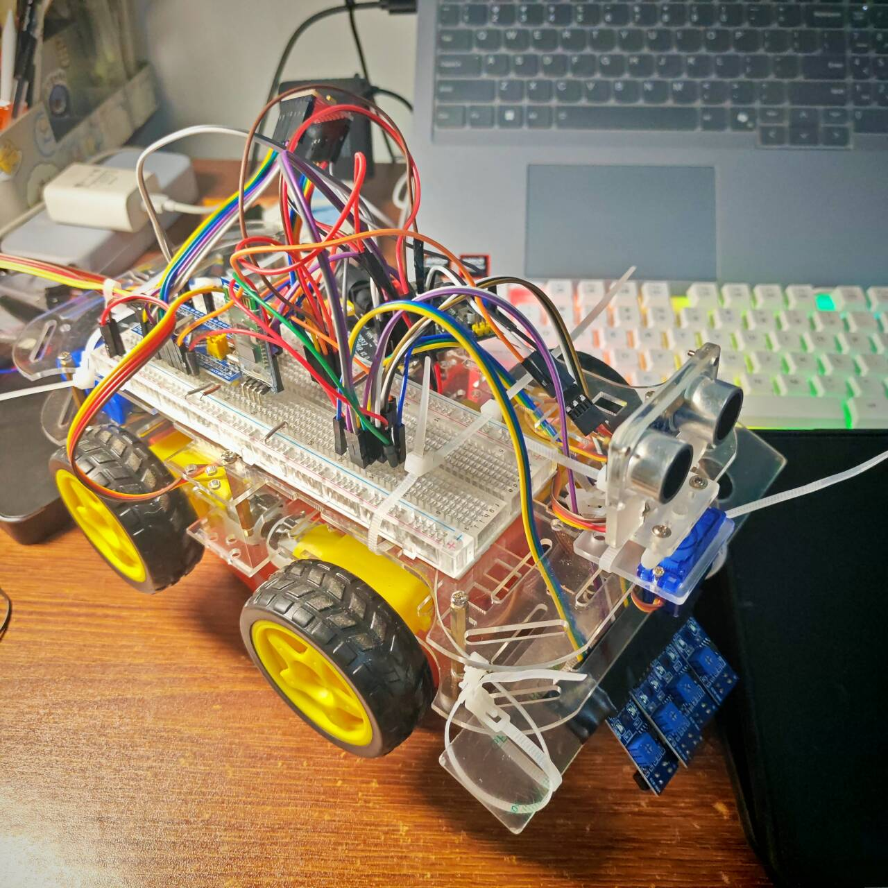
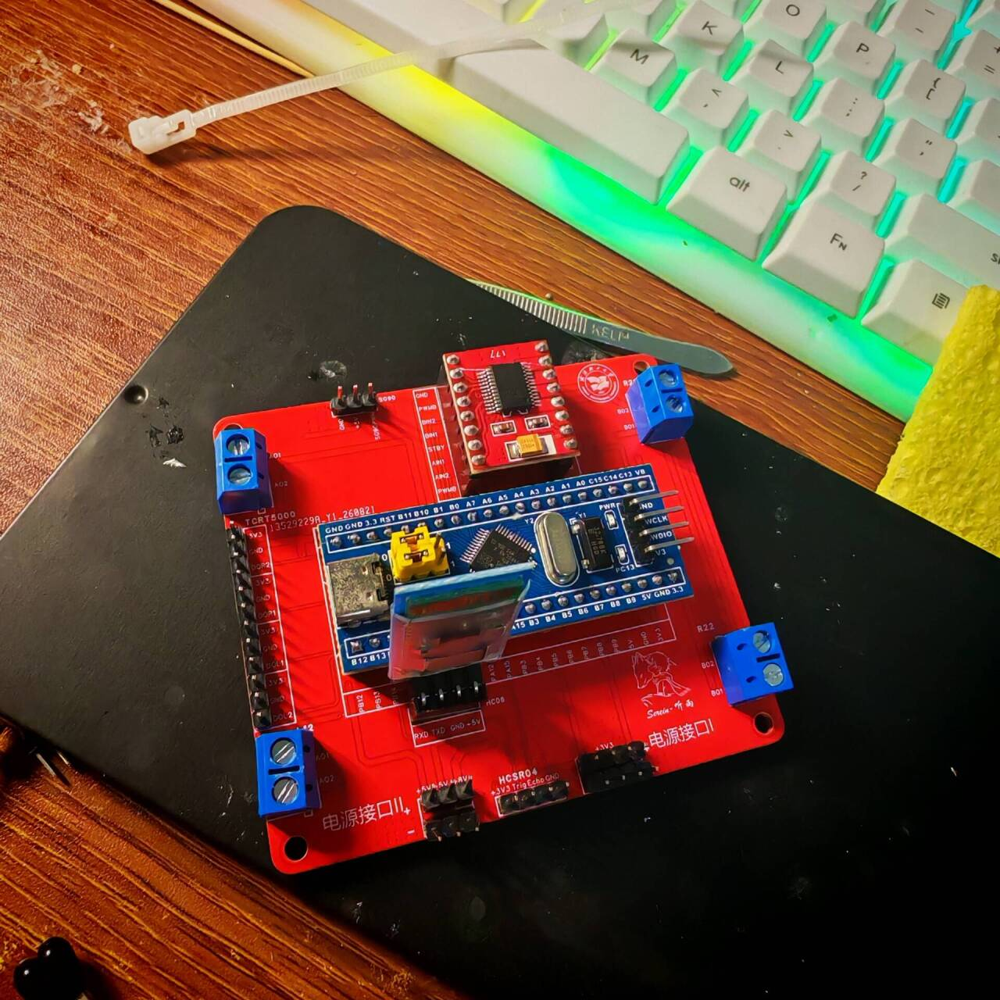
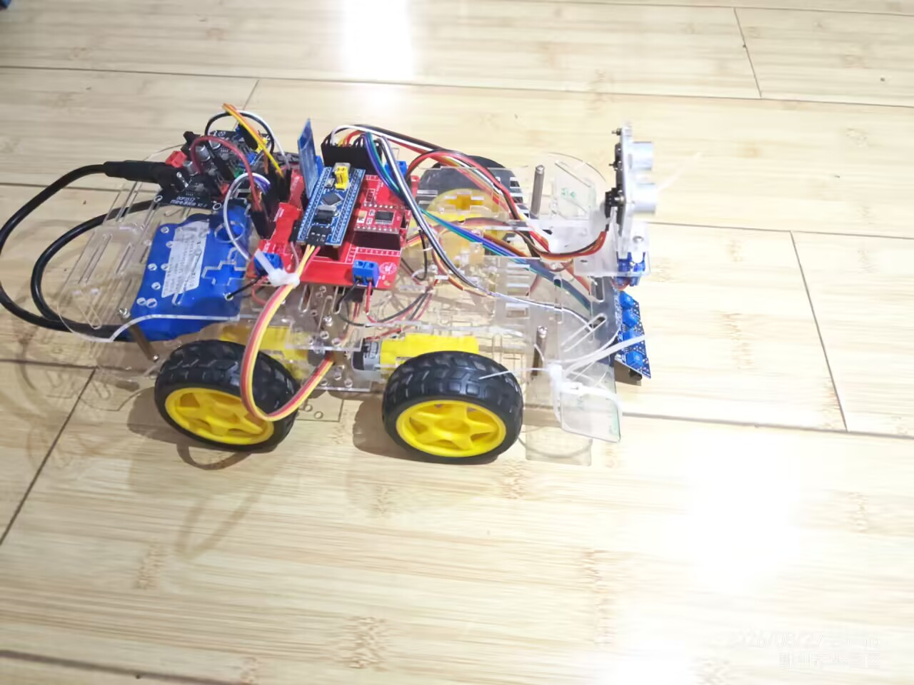
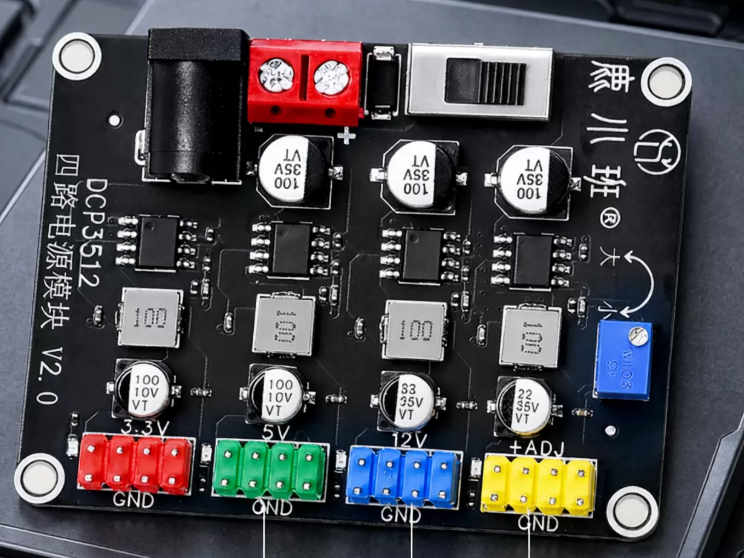
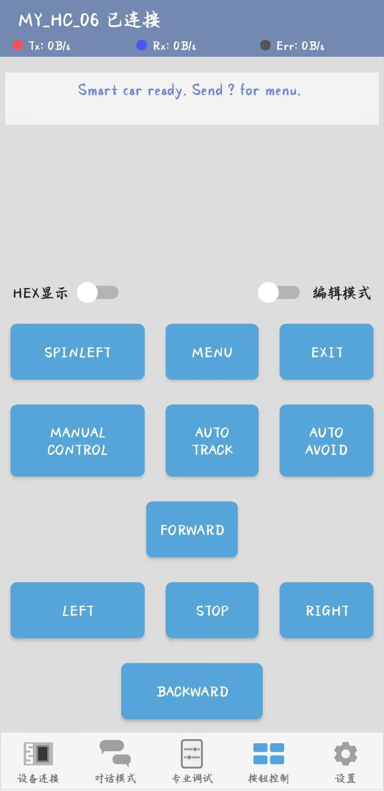
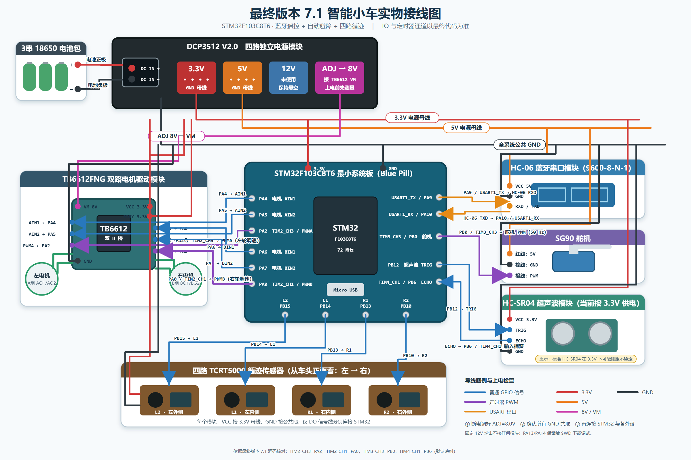
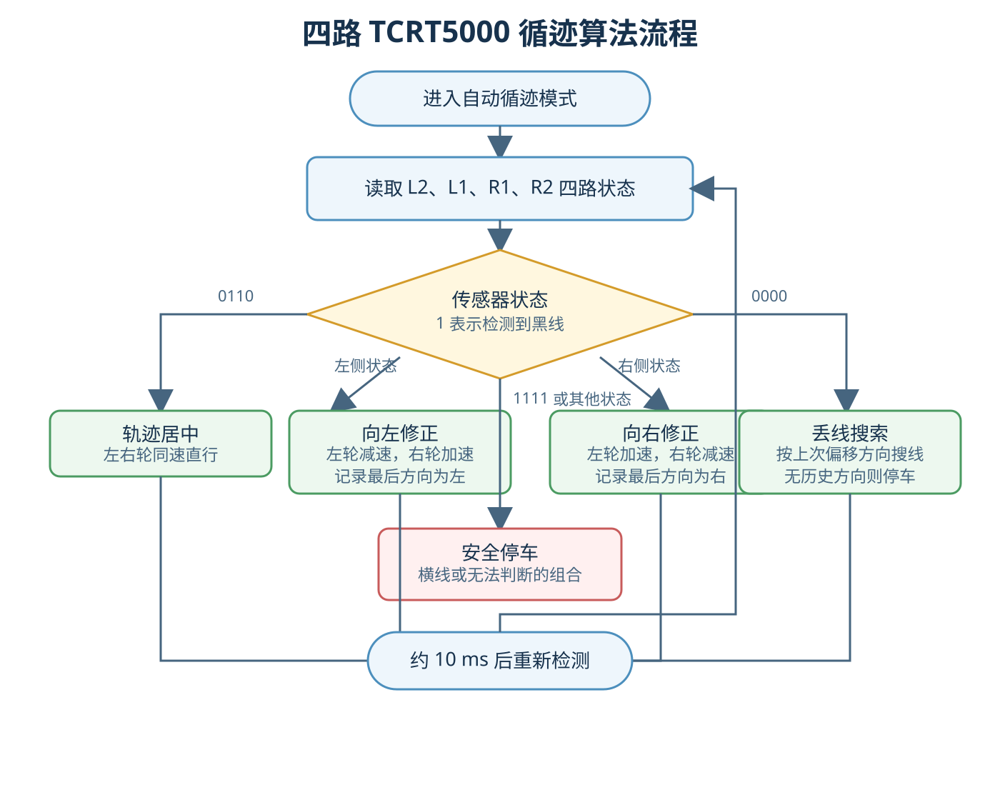
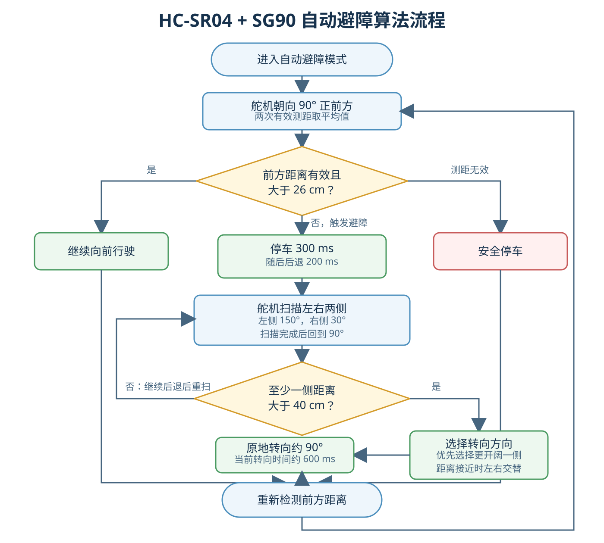
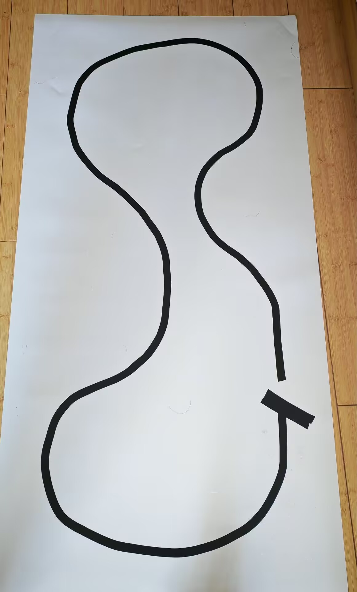

<div align="center">

# STM32 智能小车

基于 STM32F103C8T6 的蓝牙遥控、自动循迹与自动避障小车


</div>

> **当前状态：** 蓝牙遥控、自动循迹和自动避障三种模式已整合到 7.1 版本，并完成实车测试与演示视频发布，当前综合功能完成率约为 90%。

## 项目亮点

- 📱 使用手机蓝牙调试器进行模式选择和手动控制
- 🛣️ 使用四个独立 TCRT5000 传感器实现自动循迹
- 🚧 使用 HC-SR04 与 SG90 舵机实现左右扫描自动避障
- ⚙️ 使用一个 TB6612 驱动四个 TT 电机，实现左右差速控制
- 🔋 使用 DCP3512 提供 3.3V、5V 和 8V 分路供电
- 🔄 将蓝牙遥控、自动循迹和自动避障整合到统一菜单
- 🧰 完整记录接线、算法、测试数据和故障排查过程

## 快速导航

- [项目简介](#project-introduction)
- [项目功能](#features)
- [硬件组成](#hardware)
- [电源系统设计](#power-system)
- [系统整体结构](#system-architecture)
- [接线与引脚说明](#wiring)
- [软件结构](#software)
- [算法逻辑](#algorithms)
- [项目开发过程](#development)
- [项目时间线](#timeline)
- [测试结果](#tests)
- [项目演示视频](#demo-video)
- [问题及解决方法](#problems)
- [项目目录说明](#directory)
- [当前进度](#progress)
- [后续改进计划](#roadmap)

<a id="project-introduction"></a>

## 1. 项目简介

<p align="center">
  
</p>

<p align="center"><em>STM32 智能小车 7.1 版本实物</em></p>

本项目是一辆基于 STM32F103C8T6 微控制器设计的四轮智能小车。项目使用 TB6612 驱动四个 TT 电机，并搭载 HC-06 蓝牙模块、HC-SR04 超声波测距模块、SG90 舵机和四个独立的 TCRT5000 红外传感器，实现蓝牙遥控、自动避障和自动循迹三种运行模式。

在跟随 UP 主“江协科技”学习 C51 单片机及 STM32 相关知识后，为了巩固所学内容，我采用项目驱动的方式开发这辆智能小车，将分散学习的外设驱动和控制知识应用到一个完整项目中。同时，希望通过硬件搭建、程序调试、功能整合和故障排查，提高自己分析问题与解决实际问题的能力。

项目不仅关注功能实现，也会记录电源设计、硬件接线、程序结构、测试结果和故障排查过程。由于前期使用的电机线较细，而且面包板和杜邦线随着使用时间增加容易出现接触不良，后续计划更换质量更好、连接更可靠的接口线，并设计专用 PCB 扩展板，提高整车长期运行的稳定性和可靠性。

| 项目 | 内容 |
|---|---|
| 主控制器 | STM32F103C8T6 最小系统板 |
| 开发语言 | C 语言 |
| 开发环境 | Keil MDK |
| 电机驱动 | TB6612 |
| 运行模式 | 蓝牙遥控、自动循迹、自动避障 |
| 当前版本 | 7.1 蓝牙 + 避障 + 循迹 |
| 开始时间 | 2026 年 7 月 15 日 |
| 当前完成度 | 约 90% |

<a id="features"></a>

## 2. 项目功能

### 2.1 基础运动控制

- 使用 PWM 控制左右两侧电机速度。
- 实现前进、后退、停止、普通转向和原地转向。
- 通过调整左右轮速度差实现差速转向。
- 三种运行模式共同调用底层电机控制功能。

### 2.2 蓝牙遥控模式

- 使用 HC-06 与手机蓝牙调试器通信。
- 在手机中编辑自定义按键，发送对应的单字符数据。
- 控制小车前进、后退、左右转向、原地旋转和停止。
- 收到无法识别的手动指令时停车，避免沿用上一次动作。

| 指令 | 功能 | 指令 | 功能 |
|---|---|---|---|
| `1` | 进入蓝牙遥控 | `F` | 前进 |
| `2` | 进入自动循迹 | `B` | 后退 |
| `3` | 进入自动避障 | `L` / `R` | 左转 / 右转 |
| `X` | 停止并退出模式 | `A` / `D` | 原地左转 / 右转 |
| `?` | 显示菜单和状态 | `S` | 停止 |

### 2.3 自动避障模式

- 使用 HC-SR04 测量前方障碍物距离。
- 检测到障碍物后停车并后退。
- 使用 SG90 带动超声波模块扫描左右两侧。
- 比较左右距离并选择合适的转向方向。
- 两侧均无法通行时继续后退并重新扫描。

### 2.4 自动循迹模式

- 使用四个独立 TCRT5000 传感器检测黑色轨迹线。
- 根据四路状态判断轨迹位于左侧、中央或右侧。
- 通过左右轮差速完成不同幅度的方向修正。
- 丢线时按照最后一次检测到轨迹的方向继续搜线。

### 2.5 多模式整合

蓝牙遥控、自动循迹和自动避障已经整合到 7.1 版本。小车上电后保持停止，通过手机蓝牙菜单选择模式；退出当前模式后，电机先停止，再返回菜单状态。

<a id="hardware"></a>

## 3. 硬件组成

| 硬件模块 | 型号或数量 | 主要作用 |
|---|---|---|
| 主控制器 | STM32F103C8T6 最小系统板 | 读取传感器并执行控制程序 |
| 电机驱动 | 1 个 TB6612 | 驱动左右两组 TT 电机 |
| 直流减速电机 | 4 个 TT 电机 | 为小车提供行驶动力 |
| 蓝牙模块 | HC-06 | 接收手机控制数据 |
| 超声波模块 | HC-SR04 | 测量障碍物距离 |
| 舵机 | SG90 | 带动超声波模块扫描 |
| 循迹传感器 | 4 个独立 TCRT5000 | 检测黑色轨迹线 |
| 电池组 | 3 节 18650 串联 | 组成约 12V 输入电源 |
| 电源模块 | DCP3512 四路电源模块 V2.0 | 提供多路工作电压 |
| 小车底盘 | 四轮底盘 | 安装电机、传感器和电路 |
| 临时连接 | 面包板、杜邦线和电机线 | 原型阶段电路连接 |

四个 TT 电机分为左右两组，每侧两个电机并联。两组电机分别连接到 TB6612 的 A、B 两路输出，通过左右两侧的速度差实现转向。

> **注意：** 每侧两个电机并联后会增加单路驱动电流。后续设计 PCB 时，需要进一步确认电机启动电流和堵转电流是否处于 TB6612 的允许范围内。

<a id="power-system"></a>

### 3.1 PCB 扩展板（V2.0.1）

在 7.1 版本稳定运行后，为减少面包板和杜邦线带来的接触不良问题，设计了 V2.0.1 智能小车扩展板，并完成打样焊接与实车装配。

<p align="center">
  
</p>

<p align="center"><em>V2.0.1 扩展板实物（红色扩展板，上面插接 STM32F103C8T6 最小系统板）</em></p>

<p align="center">
  
</p>

<p align="center"><em>装车后的智能小车实物</em></p>

扩展板集成以下接口与电路：

| 扩展板功能 | 说明 |
|---|---|
| STM32F103C8T6 最小系统板 | 通过排针/排母插座插接主控板 |
| TB6612 电机驱动 | 驱动左右两组 TT 电机 |
| 电源输入 | DC 接口与电源接口 I/II/III 接线端子 |
| 电压分配 | 3.3V / 5V / 8V 分路供电 |
| 电机接口 | 左右两组电机接线端子 |
| 传感器接口 | 4× TCRT5000、HC-SR04 |
| 蓝牙接口 | HC-06 |
| 舵机接口 | SG90 |

原理图、BOM 与 Gerber 导出文件位于 `相关代码及PCB设计/V2.0.1/`。可编辑的嘉立创 EDA（EasyEDA Pro）工程未包含在仓库中，如需修改板子请在嘉立创 EDA 中获取源工程后重新导出。

## 4. 电源系统设计

整车使用 3 节 18650 锂电池串联组成约 12V 电池组，通过 DC 接口接入 DCP3512 四路独立电源模块，并使用模块自带开关控制整车电源。电源模块将输入电压转换成不同硬件所需的工作电压。

<p align="center">
  
</p>

<p align="center"><em>DCP3512 四路独立电源模块</em></p>

| 输出电压 | 供电对象 |
|---|---|
| 3.3V | STM32、TB6612 的 VCC 与 STBY、四个 TCRT5000、HC-SR04 |
| 5V | SG90 舵机、HC-06 蓝牙模块 |
| ADJ 调至 8V | TB6612 的 VM 电机动力电源 |
| 固定 12V | 当前未使用 |

所有模块采用共地连接，使 STM32、传感器和电机驱动使用相同的电压参考。逻辑电路与电机动力部分使用不同电压供电，在满足模块工作要求的同时，减少电机运行对控制电路的影响。

> **接线提示：** ADJ 通道接入 TB6612 的 VM 前，应先使用万用表确认输出电压为 8V。

<a id="system-architecture"></a>

## 5. 系统整体结构

STM32F103C8T6 是智能小车的控制中心。HC-06 负责接收手机发送的模式选择和运动控制指令；四个 TCRT5000 负责检测地面轨迹；HC-SR04 和 SG90 负责检测不同方向的障碍物。STM32 处理信息后，通过 TB6612 控制左右两组 TT 电机。

### 5.1 数据流

- 蓝牙遥控：手机蓝牙调试器 → HC-06 → STM32 → TB6612 → 电机。
- 自动循迹：TCRT5000 → STM32 循迹判断 → TB6612 → 电机。
- 自动避障：HC-SR04 与 SG90 → STM32 避障判断 → TB6612 → 电机。
- 模式选择：手机按键 → HC-06 → STM32 模式菜单。

### 5.2 手机控制界面

<p align="center">
  
</p>

<p align="center"><em>手机蓝牙调试器最终控制界面</em></p>

界面包含 `MENU`、`EXIT`、`MANUAL CONTROL`、`AUTO TRACK`、`AUTO AVOID` 以及手动行驶按键。

### 5.3 上电操作流程

1. 打开 DCP3512 电源开关。
2. STM32 完成模块初始化，小车保持停止。
3. 手机连接名为 `MY_HC_06` 的蓝牙模块。
4. 手机接收到 `Smart car ready. Send ? for menu.`。
5. 点击 `MENU` 发送 `?`，查看菜单和当前状态。
6. 点击对应按键进入蓝牙遥控、自动循迹或自动避障模式。
7. 点击 `EXIT` 退出当前模式，小车停止并返回菜单状态。

任意时刻只允许一种模式控制电机。切换模式前需要先退出当前模式，防止不同功能同时发送电机控制命令。

<a id="wiring"></a>

## 6. 接线与引脚说明

### 6.1 最终版实物接线图



### 6.2 STM32F103C8T6 引脚定义

下图展示 STM32F103C8T6 的 LQFP48 引脚分布及主要复用功能，可用于核对本项目使用的 GPIO、串口和定时器通道。


### 6.3 TB6612 电机驱动

| TB6612 引脚 | STM32 或电源连接 | 作用 |
|---|---|---|
| AIN1 | PA4 | 左侧电机方向控制 |
| AIN2 | PA5 | 左侧电机方向控制 |
| PWMA | PA2 / TIM2_CH3 | 左侧电机 PWM 调速 |
| BIN1 | PA6 | 右侧电机方向控制 |
| BIN2 | PA7 | 右侧电机方向控制 |
| PWMB | PA0 / TIM2_CH1 | 右侧电机 PWM 调速 |
| VCC | 3.3V | 逻辑电源 |
| STBY | 3.3V | 使能电机驱动 |
| VM | 8V | 电机动力电源 |
| GND | 公共地 | 电源与信号参考地 |

### 6.4 其他模块

| 模块 | 模块引脚 | STM32 或电源连接 |
|---|---|---|
| HC-06 | RXD | PA9 / USART1_TX |
| HC-06 | TXD | PA10 / USART1_RX |
| HC-06 | VCC | 5V |
| SG90 | PWM | PB0 / TIM3_CH3 |
| SG90 | 电源 | 5V |
| HC-SR04 | TRIG | PB12 |
| HC-SR04 | ECHO | PB6 / TIM4_CH1 |
| HC-SR04 | VCC | 3.3V |
| TCRT5000 左外 L2 | DO | PB15 |
| TCRT5000 左内 L1 | DO | PB14 |
| TCRT5000 右内 R1 | DO | PB13 |
| TCRT5000 右外 R2 | DO | PB10 |

HC-06 使用 `9600-8-N-1` 串口参数。四个 TCRT5000 均使用 3.3V 供电；所有模块共地。PA13 和 PA14 保留用于 SWD 下载调试。

<a id="software"></a>

## 7. 软件结构

7.1 版本采用模块化方式组织程序，不同硬件和功能分别放在独立文件中，`main.c` 负责模式选择和整体调度。

```text
main.c
│
├── 模式菜单与程序调度
│   └── Serial：蓝牙通信和指令接收
│
├── 蓝牙遥控模式
│   └── Car → Motor → PWM
│
├── 自动循迹模式
│   ├── TrackSensor：读取四路循迹状态
│   └── Track → Car → Motor → PWM
│
└── 自动避障模式
    ├── HC_SR04：测量障碍物距离
    ├── Servo → PWMServo：控制舵机扫描
    └── Avoid → Car → Motor → PWM
```

| 程序模块 | 主要职责 |
|---|---|
| `main.c` | 初始化各模块，处理蓝牙菜单，调度三种运行模式 |
| `Serial` | 配置 USART1，接收和发送蓝牙数据，处理退出指令 |
| `Car` | 封装前进、后退、转向、旋转、停车和急停功能 |
| `Motor` | 控制左右两侧电机的方向和速度 |
| `PWM` | 使用 TIM2 产生电机调速信号 |
| `TrackSensor` | 读取四个 TCRT5000 的数字状态 |
| `Track` | 执行差速循迹和丢线搜索 |
| `HC_SR04` | 触发测距，通过 TIM4 输入捕获计算距离 |
| `Servo` / `PWMServo` | 使用 TIM3 控制 SG90 角度 |
| `Avoid` | 执行前方检测、后退、扫描和转向决策 |
| `Delay` | 提供程序需要的延时功能 |

工程中还保留了 `OLED`、`Key` 和 `LED` 文件，但 7.1 最终程序没有初始化这些模块，它们属于开发过程遗留或预留功能。

<a id="algorithms"></a>

## 8. 工作模式与算法逻辑

### 8.1 自动循迹算法



四路传感器从车头方向观察依次为 `L2、L1、R1、R2`。程序将检测结果组合成四位二进制状态，其中 `1` 表示检测到黑线，`0` 表示没有检测到黑线。

当前算法采用固定速度状态表，而不是 PID 控制。黑线位于左侧时降低左轮速度、提高右轮速度；位于右侧时执行相反动作。

<details>
<summary><strong>点击查看完整循迹状态与速度表</strong></summary>

| 状态 | 黑线位置 | 控制动作 | 左轮速度 | 右轮速度 |
|---|---|---|---:|---:|
| `0110` | 中央 | 直行 | 32 | 32 |
| `0100` | 略偏左 | 小幅左转 | 20 | 42 |
| `1100`、`1110` | 明显偏左 | 中幅左转 | 10 | 46 |
| `1000` | 左外侧 | 大幅左转 | 0 | 50 |
| `0010` | 略偏右 | 小幅右转 | 42 | 20 |
| `0011`、`0111` | 明显偏右 | 中幅右转 | 46 | 10 |
| `0001` | 右外侧 | 大幅右转 | 50 | 0 |
| `0000` | 丢失轨迹 | 按上一次方向搜线 | 依据方向 | 依据方向 |
| `1111` | 横线或大面积黑色 | 停车 | 0 | 0 |

以上数值为程序内部 `0～100` 的相对速度，不代表电机实际转速。

</details>

程序会记录最后一次检测到黑线的偏移方向。丢线后向最后发现黑线的一侧搜索；刚进入循迹模式且没有历史方向时停车。无法明确判断的其他状态也会停车，避免执行错误动作。

### 8.2 自动避障算法



自动避障由前方检测、停车后退、左右扫描、方向选择和原地转向五个阶段组成。

1. 舵机保持 `90°`，超声波朝向正前方。
2. 每个方向测量两次有效距离并取平均值。
3. 前方距离大于 26cm 时继续前进。
4. 前方距离小于或等于 26cm 时停车 300ms，再后退 200ms。
5. 舵机转到 `150°` 测量左侧，再转到 `30°` 测量右侧，最后回到 `90°`。
6. 至少一侧距离大于 40cm 时选择方向并原地旋转约 600ms。
7. 两侧都不大于 40cm 时继续后退并重新扫描。

| 左侧情况 | 右侧情况 | 处理方式 |
|---|---|---|
| 大于 40cm | 不大于 40cm | 向左转 |
| 不大于 40cm | 大于 40cm | 向右转 |
| 均不大于 40cm | 均被阻挡 | 继续后退并扫描 |
| 均大于 40cm，差值超过 20cm | 均可通行 | 选择距离较大的一侧 |
| 均大于 40cm，差值不超过 20cm | 空间接近 | 左右方向交替选择 |

前方测距无效时小车停止；侧向无回波时暂按 400cm 的开阔距离处理。避障期间会持续检测 `X` 指令，收到指令后立即停止并退出。

<a id="development"></a>

## 9. 项目开发过程

项目采用“单模块验证 → 功能组合 → 实车测试 → 问题排查 → 最终整合”的方式推进。

| 版本 | 开发内容 | 阶段成果 |
|---|---|---|
| 1.1 | PWM 驱动一个 TT 电机 | 完成单电机转动和调速 |
| 1.2 | PWM 驱动四个 TT 电机 | 使用两路 PWM 控制左右电机组 |
| 1.3 | 运动控制模块化 | 封装小车基本运动功能 |
| 2.1 | HC-06 蓝牙模块 | 实现手机与 STM32 串口通信 |
| 3.1 | SG90 舵机 | 实现角度控制 |
| 4.1 | HC-SR04 超声波 | 实现距离测量 |
| 5.1 | 基础自动避障 | 实现固定停车、后退和转向 |
| 5.2 | 避障误差测试 | 测试刹车距离和舵机方向 |
| 5.3 | 舵机扫描避障 | 比较左右距离并选择方向 |
| 6.1 | 循迹功能测试 | 读取四路状态并测试规则 |
| 6.2 | 循迹稳定版本 | 完成速度调整和丢线搜索 |
| 7.1 | 三种模式整合 | 完成统一蓝牙菜单和模式调度 |

<a id="timeline"></a>

## 10. 项目时间线

| 日期 | 项目进展 | 结果与说明 |
|---|---|---|
| 2026-07-15 | 项目初始搭建 | 建立 STM32 工程，开始测试电机驱动 |
| 2026-07-16 | PWM 驱动四个 TT 电机 | 使用 TIM2 通道 1 和通道 3 控制左右电机组 |
| 2026-07-17 | 处理整车供电问题 | 完成 STM32、TB6612 和电机的初步供电连接 |
| 2026-07-30 | 测试基础自动避障 | 发现持续后退左转及右侧电机不转 |
| 2026-08-06 | 更换整车供电方案 | 改用 3 节 18650 和 DCP3512 |
| 2026-08-06 | 排查右侧电机故障 | 判断 TB6612 与面包板接触不良 |
| 2026-08-06 | 开始进阶避障 | 加入 SG90 左右扫描 |
| 2026-08-07 | 测试避障误差 | 测得约 11cm 刹车距离并修正舵机方向 |
| 2026-08-09 | 完善扫描避障 | 完成左右距离比较和方向选择 |
| 2026-08-10 | 开始循迹测试 | 读取 TCRT5000 状态并调整循迹规则 |
| 2026-08-12 | 循迹路线测试 | 完成 12 次专项测试 |
| 2026-08-13 | 完成循迹稳定版 | 冻结当前速度参数和搜线逻辑 |
| 2026-08-14 | 完成三模式整合 | 形成 7.1 版本和手机按键菜单 |
| 2026-08-14 | 发布整合演示视频 | 在哔哩哔哩发布三功能整合演示视频并更新 README |
| 2026-08-14 起 | 持续完善项目文档 | 整理接线、算法、测试和问题记录 |
| 后续 | 设计 PCB 控制板 | 提高硬件连接的长期可靠性 |

<a id="tests"></a>

## 11. 测试结果

蓝牙遥控、自动循迹、自动避障以及三种模式切换均已完成实车测试，当前综合功能完成率约为 90%，基本满足个人项目演示需求。

### 11.1 循迹测试路线

循迹路线使用黑色胶带制作，包含直线、连续弯道、急弯和较窄的曲线位置。路线上的箭头用于标记小车行驶方向。

<p align="center">
  
</p>

<p align="center"><em>自动循迹实车测试路线</em></p>

### 11.2 循迹专项测试

2026 年 8 月 12 日进行了包含 12 次运行的专项测试：

- 约 10 次能够自主完成路线，当日完成率约为 83.3%。
- 排除两次异常后，平均完成时间约为 18.73 秒。
- 最快完成时间为 17.97 秒。
- 偶尔会在连续弯道位置出现卡顿。
- 后续调整后的综合完成率提高到约 90%。

<details>
<summary><strong>点击查看 12 次循迹测试原始数据</strong></summary>

第一组：18.02、22.65（卡顿并人工干预）、19.69、19.69、19.36、17.97 秒。

第二组：19.01、21.70（发生一次卡顿）、18.59、18.12、18.69、18.17 秒。

</details>

### 11.3 自动避障测试

自动避障经过实车测试，能够完成前方检测、提前停车、后退、舵机扫描、方向选择和重新行驶；两侧均被阻挡时能够继续后退并重新扫描，也可以通过手机 `EXIT` 按键随时退出。

### 11.4 蓝牙和模式切换测试

手机能够连接 HC-06 并通过自定义按键控制小车。三种模式均可以正常进入和退出，测试期间未发现影响正常演示的死机或无法退出问题。

<a id="demo-video"></a>

## 12. 项目演示视频

整合演示视频集中展示以下内容：

1. 手机连接 HC-06，并通过菜单选择运行模式；
2. 蓝牙遥控小车前进、后退、转向和停止；
3. 自动检测障碍物、扫描左右方向并完成转向；
4. 在黑色轨迹路线上的自动循迹效果；
5. 使用 `EXIT` 退出当前模式并返回菜单。

> **视频状态：** ✅ 已发布至哔哩哔哩。

### 观看地址

[点击观看 STM32 智能小车三功能整合演示视频（哔哩哔哩）](https://www.bilibili.com/video/BV1uMgK6bE7M/)

<a id="problems"></a>

## 13. 遇到的问题及解决方法

### 13.1 电机连接线过细

早期使用的电机线较细且接头不够牢固，小车运动时容易松动，导致电机偶尔不转。当前通过重新固定连接维持运行，后续将更换线径更合适、接口更可靠的连接线。

### 13.2 右侧两个电机不转

自动避障测试期间发现右侧两个电机不转。使用万用表检查后，发现 TB6612 的 BO1、BO2 没有正常输出。将 TB6612 从面包板上拆下并改用杜邦线直接连接后，右侧电机基本恢复，初步判断为 TB6612 与面包板接触不良。

### 13.3 面包板长期使用产生偶发故障

随着插拔次数和使用时间增加，面包板内部触点及模块连接的可靠性逐渐下降，有时需要调整接线才能恢复正常。后续计划设计 PCB 控制板，减少面包板和临时接线。

### 13.4 早期供电方案不便于分配

项目早期使用四节普通电池供电，不同模块的电压和电流需求难以统一。之后改用 3 节 18650 串联和 DCP3512，将 3.3V、5V 和 8V 分路供给不同模块。

### 13.5 舵机扫描方向相反

舵机实际安装方向与程序最初设想不同，导致避障方向选反。通过实车测试重新确定角度：`150°` 为物理左侧、`90°` 为正前方、`30°` 为物理右侧。

### 13.6 小车存在刹车距离

速度参数为 50 时，从执行停车程序到实际停止约有 11cm 的移动距离。因此将前方避障触发距离设为 26cm，为停车和后续动作预留空间。

### 13.7 避障程序重复后退和左转

早期程序出现持续后退和左转的问题。排查发现该现象同时受到右侧电机不转影响。恢复电机连接后，又将避障流程拆分为停车、后退、扫描、方向判断和原地转向，使每轮动作结束后返回主循环。

### 13.8 连续弯道偶尔卡顿

循迹测试中，传感器状态偶尔会在 `0000` 和 `0010` 之间切换，导致小车在连续弯道处小幅抖动。当前使用最后方向记忆进行搜线，大多数情况下可以重新找到轨迹。

可选优化包括：对 `0000` 增加连续周期确认、降低搜线速度、增加传感器滤波，以及尝试比例或 PID 控制。

<a id="directory"></a>

## 14. 项目目录说明

```text
stm32_-smart_-car
├── README.md
├── 代码部分
│   └── V1.0.0
│       ├── 1.1PWM驱动一个TT电机
│       ├── 1.2PWM驱动四个TT电机
│       ├── 1.3小车运动控制速度&方向模块化
│       ├── 2.1蓝牙模块（HC-06）
│       ├── 3.1增加舵机模块（SG90）
│       ├── 4.1超声波测距模块（HC-SR04新版）
│       ├── 5.1基础自动避障
│       ├── 5.2自动避障误差测试
│       ├── 5.3舵机扫描自动避障
│       ├── 6.1循迹测试
│       ├── 6.2循迹稳定版本
│       └── 7.1蓝牙+避障+循迹
└── 文本记录
    ├── Goal.txt
    ├── Problem.txt
    ├── 循迹测试记录.txt
    └── images
```

当前最终版本位于：

```text
代码部分/V1.0.0/7.1蓝牙+避障+循迹
```

| 7.1 目录或文件 | 主要内容 |
|---|---|
| `Hardware` | 电机、蓝牙、舵机、超声波、循迹和避障模块 |
| `Library` | STM32 标准外设库 |
| `Start` | 启动文件、系统文件和内核支持 |
| `System` | 延时等基础系统功能 |
| `User` | `main.c`、中断处理和工程配置 |
| `DebugConfig` | Keil 调试配置 |
| `Listings` / `Objects` | Keil 编译生成文件 |
| `Project.uvprojx` | Keil 工程文件 |

使用 Keil 打开 7.1 目录中的 `Project.uvprojx` 即可加载最终版工程。

<a id="progress"></a>

## 15. 当前进度

| 项目内容 | 当前状态 |
|---|---|
| 电机 PWM 与运动控制 | ✅ 已完成 |
| 手机蓝牙遥控与按键菜单 | ✅ 已完成 |
| 超声波测距与舵机扫描 | ✅ 已完成 |
| 自动避障 | ✅ 已完成并实车测试 |
| 四路红外循迹 | ✅ 已完成并实车测试 |
| 三种模式整合 | ✅ 已完成，位于 7.1 版本 |
| 电源系统搭建 | ✅ 已完成 |
| 接线图和算法流程图 | ✅ 已完成 |
| 项目 README | ✅ 已完成初版 |
| 三功能整合演示视频 | ✅ 已录制并发布至哔哩哔哩 |
| PCB 控制板 | ✅ 已完成（V2.0.1 打样焊接） |

<a id="roadmap"></a>

## 16. 后续改进计划

### 第一阶段：持续完善项目资料

- 检查 README 与最终代码是否一致。
- 根据后续测试结果补充 README 与演示资料。

### 第二阶段：改善硬件连接

- 更换过细的电机连接线。
- 使用更牢固的接口并减少面包板连接。
- 固定电源、驱动和传感器模块。
- 进行更长时间的连续运行测试。

### 第三阶段：设计 PCB 控制板

根据 7.1 最终接线方案设计智能小车 PCB 控制板或扩展底板，集成：

- STM32F103C8T6 最小系统板接口；
- TB6612 电机驱动和电机接口；
- HC-06、SG90、HC-SR04 和四路循迹接口；
- 电源输入及不同电压分配；
- SWD 下载调试接口；
- 电源开关、指示和滤波电路。

设计时重点考虑电机电流、走线宽度、逻辑与动力电源分区、共地、接口防松和安装孔位置。

#### V2.0.1 已完成

V2.0.1 扩展板已完成设计并打样焊接，原理图、BOM 与 Gerber 位于 `相关代码及PCB设计/V2.0.1/`，实车装配见「3.1 PCB 扩展板（V2.0.1）」。

#### V2.0.2 板子改进清单

根据实车装配与测试发现的问题，V2.0.2 需改进以下几点：

1. **增加电源检测 LED**：板子未加电源指示灯，无法直观判断是否上电；在电源轨与 GND 之间增加带限流电阻的电源指示 LED。
2. **蓝牙模块远离最小系统板**：HC-06 蓝牙模块与 STM32 最小系统板距离过近，布局拥挤且可能相互干扰；需调整蓝牙接口位置，保持安全间距。
3. **修正两个电机接口极性**：板子上有两个电机接口的引脚序/极性接反，导致对应电机反转；需交换引脚序或修正丝印极性。
4. **优化结构布局与绕线**：电机线等走线在结构上可能需要绕线，存在交叉与遮挡；需优化接口位置、走线走向、接口防松与安装孔布局。

### 第四阶段：PCB 制作与验证

- 检查原理图和 PCB 走线；
- 打样并焊接元件；
- 分模块检查 3.3V、5V 和 8V 电源；
- 测试所有外设接口；
- 烧录 7.1 程序并重新测试三种模式；
- 对比 PCB 与面包板方案的长期稳定性。

后续开发路线：

```text
持续完善 README → 确定最终接口 → 绘制原理图 → 设计 PCB
        → 打样焊接 → 整车稳定性测试
```

<div align="center">

如果这个项目对你有帮助，欢迎参考其中的模块化开发、实车调试和问题排查思路。

[返回顶部 ↑](#stm32-智能小车)

</div>
